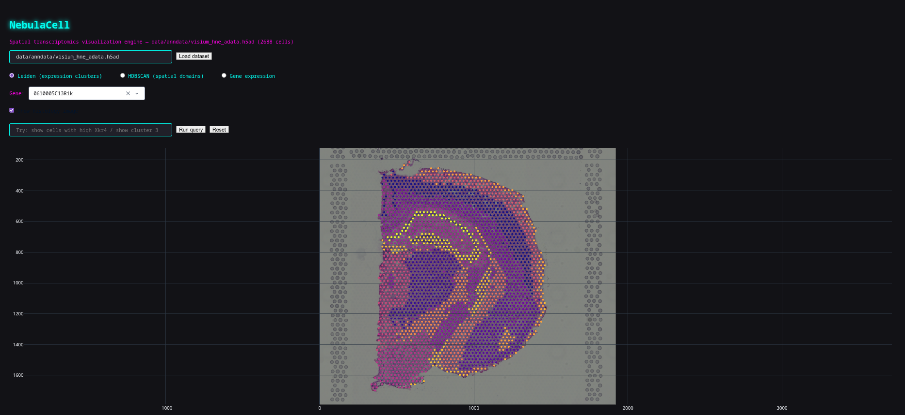
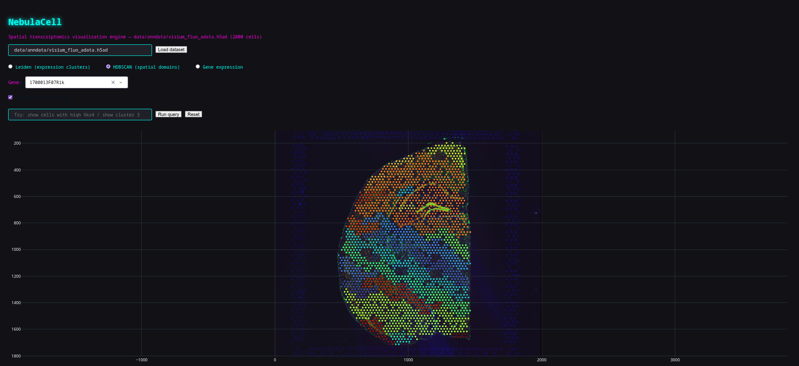
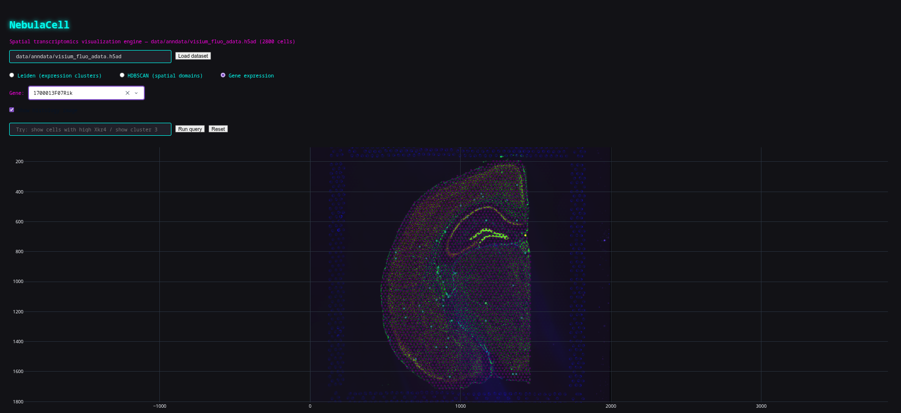
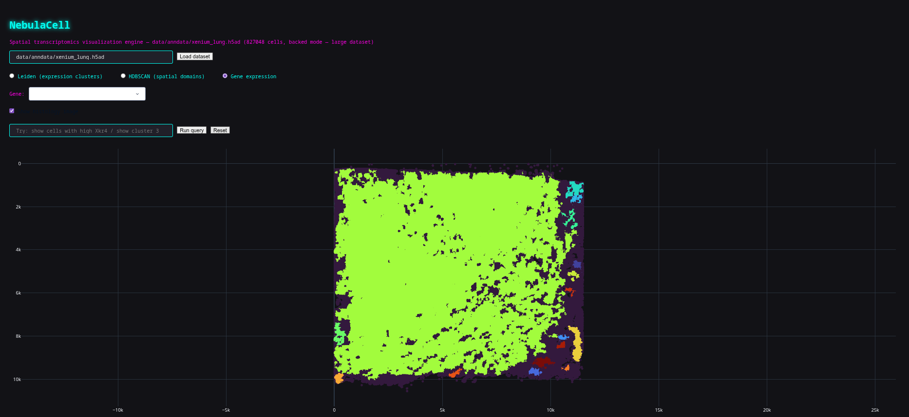
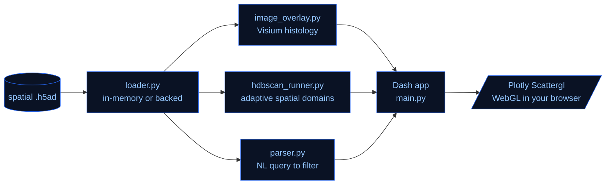

<div align="center">


# NEBULACELL


<p align="center">
  <a href="LICENSE"></a>
  <a href="https://www.python.org/"></a>
  <a href="https://github.com/Eswar-mse/Nebulacell/actions"></a>
  <a href="https://github.com/Eswar-mse/Nebulacell/commits/main"></a>
  <a href="https://github.com/Eswar-mse/Nebulacell/stargazers"></a>
  <a href="https://github.com/Eswar-mse/Nebulacell/network/members"></a>
  <a href="https://github.com/Eswar-mse/Nebulacell/issues"></a>
  <br/>
  
  
  
  
  
  
  
</p>


<br/>

<a href="#what-is-nebulacell"></a>
<a href="#gallery"></a>
<a href="#how-it-works"></a>
<a href="#features"></a>
<a href="#quick-start"></a>
<a href="#natural-language-queries"></a>
<a href="#supported-assays"></a>
<a href="#architecture"></a>
<a href="#limitations-and-roadmap"></a>
<a href="#contributing"></a>
<a href="#citation"></a>
<a href="#author"></a>

<br/><br/>



</div>


<div align="center">
<h3>WHAT IS NEBULACELL</h3>
</div>

**NebulaCell** is an interactive, GPU-accelerated dashboard for exploring spatial single-cell and spot data. Load a real `.h5ad` file, look at it in your browser, recolour it by any gene, find tissue domains by density, and ask questions in plain language, all in one tab and without a notebook.

Spatial transcriptomics couples gene expression with physical tissue coordinates, but most exploratory tooling either stops scaling past a few thousand points or needs notebook-driven analysis for every question. NebulaCell aims for an interactive middle ground. It has been stress-tested on real public datasets from **2,800 to 827,000+ cells** across **Visium**, **MERFISH** and **Xenium** assay types.

> [!NOTE]
> **In plain terms.** A normal single-cell experiment tells you *what* each cell expresses. A spatial one also tells you *where* the cell sits in the tissue. NebulaCell draws every cell at its x/y position, so you can see tissue structure and its gene activity together.


<div align="center">
<h3>GALLERY</h3>
</div>
<a id="gallery"></a>

<table>
<tr>
<td width="50%" valign="top" align="center">
<b>Leiden clusters + histology overlay</b><br/>

</td>
<td width="50%" valign="top" align="center">
<b>HDBSCAN spatial domains (827k cells)</b><br/>

</td>
</tr>
<tr>
<td width="50%" valign="top" align="center">
<b>Gene expression colouring</b><br/>

</td>
<td width="50%" valign="top" align="center">
<b>Natural-language query filtering</b><br/>

</td>
</tr>
</table>

<div align="center">
<br/>
<b>Large-scale rendering</b>: 827,048 cells (10x Xenium human lung), rendered live in the browser.<br/><br/>

</div>


<div align="center">
<h3>HOW IT WORKS</h3>
</div>



**Under the hood.** Four ideas make it work:

1. **WebGL, not SVG.** Points are drawn with Plotly's `Scattergl`, so the GPU does the work. Plain SVG scatter plots start to struggle past roughly 10 to 20 thousand points, while NebulaCell has been tested at 827,000 cells without the browser choking.
2. **Two ways to cluster.** *Leiden clusters* group cells by how similar their **expression** is. *HDBSCAN domains* group cells by how densely packed they are in **space**. Switch between the two views to compare "what cells are" with "where they sit".
3. **Adaptive tuning.** HDBSCAN's `min_cluster_size` and `min_samples` default to values scaled to the dataset size. The **Recluster** control lets you change them and re-run instantly, without reloading the data.
4. **Smart loading.** NebulaCell picks in-memory or backed-mode loading from the real matrix size (cells × genes), not from the cell count alone.

<details>
<summary><b>What is HDBSCAN, in one minute?</b></summary>

<br/>

HDBSCAN is a density-based clustering method. Instead of asking you for the number of clusters up front, it looks for regions where points are packed closely together and treats sparse points as noise. `min_cluster_size` sets the smallest group worth calling a domain, and `min_samples` controls how conservative the density estimate is: higher values mark more points as noise. That is why it suits tissue, where regions have irregular shapes and no fixed count.

</details>


<div align="center">
<h3>FEATURES</h3>
</div>

| | Feature | What you get |
| :---: | :--- | :--- |
| ⚡ | **GPU-accelerated rendering** | WebGL via Plotly `Scattergl`, tested up to 827,000 cells |
| 🔬 | **Histology overlay** | Tissue image extracted from Visium-style `.h5ad` files (`adata.uns['spatial']`) and scaled to match spot coordinates. Degrades gracefully for MERFISH and Xenium, which have no histology image |
| 🧭 | **Dual clustering views** | Expression-based Leiden clusters (if present in the file) next to independently computed HDBSCAN spatial domains |
| 🎛️ | **Adaptive HDBSCAN** | Defaults scale with dataset size, plus a live **Recluster** control |
| 🧬 | **Live gene exploration** | Searchable gene dropdown recolours the whole dataset. Hover tooltips show each cell's top-expressed genes and the selected gene's value |
| 💬 | **Natural-language filtering** | Type `show cells with high Xkr4` or `show cluster 3`. A rule-based parser, with no LLM API cost, validates against the dataset before filtering |
| 📂 | **Real `.h5ad` loading** | Point it at any spatial `.h5ad` file through a path input |


<div align="center">
<h3>QUICK START</h3>
</div>

```bash
git clone https://github.com/Eswar-mse/Nebulacell.git
cd Nebulacell/nebulacell

python -m venv .venv
source .venv/bin/activate        # Windows: .venv\Scripts\activate

pip install -r ../requirements.txt

python -m app.main
```

Open **http://127.0.0.1:8050** in your browser. NebulaCell starts with a small built-in demo dataset (Visium mouse brain, 2,800 cells), so you can try it with no download or setup.

> [!TIP]
> To load your own data, paste the path to any spatial `.h5ad` file into the path input. Full instructions are in [USAGE.md](USAGE.md).


<div align="center">
<h3>NATURAL-LANGUAGE QUERIES</h3>
</div>
<a id="natural-language-queries"></a>

**In plain terms.** Type a sentence into the query box and the matching cells light up.

| You type | NebulaCell does |
| :--- | :--- |
| `show cells with high Xkr4` | Highlights cells with high expression of the gene `Xkr4` |
| `show cluster 3` | Highlights the cells that belong to cluster 3 |

**Under the hood.** A rule-based regex parser turns your sentence into a structured filter and **checks it against the loaded dataset** (does that gene exist? does that cluster exist?) before anything is applied. There is no model call, so it costs nothing, behaves the same every time, and cannot hallucinate.

> [!IMPORTANT]
> The grammar is deliberately narrow. It covers gene-expression-level and cluster-membership queries, and it is not a general-purpose language interface.


<div align="center">
<h3>SUPPORTED ASSAYS</h3>
</div>
<a id="supported-assays"></a>

| Assay | Type | Histology overlay | Verified in this project |
| :--- | :--- | :---: | :--- |
| **Visium** | Spot-based, with a tissue image | ✓ | Built-in demo: mouse brain, 2,800 cells |
| **MERFISH** | Imaging-based | none in file | Stress-tested on real public data |
| **Xenium** | Imaging-based | none in file | 827,048 cells, human lung |

> [!WARNING]
> Gene identifiers come from the source file. Some public datasets (certain Xenium exports, for example) store Ensembl IDs instead of gene symbols. NebulaCell shows whatever the file provides.


<div align="center">
<h3>ARCHITECTURE</h3>
</div>

| Layer | Technology |
| :--- | :--- |
| Dashboard / UI | Dash (Plotly) |
| Rendering | Plotly `Scattergl` (WebGL) |
| Data handling | Scanpy, AnnData |
| Spatial data | Squidpy |
| Clustering | HDBSCAN |
| NL query parsing | Rule-based regex parser, no external API |

<details>
<summary><b>Project layout</b></summary>

```text
nebulacell/
├── app/
│   ├── main.py                  Dash app entrypoint, layout, callbacks
│   ├── data/
│   │   ├── loader.py            .h5ad loading, in-memory vs backed-mode logic
│   │   └── image_overlay.py     Histology image extraction (Visium uns['spatial'])
│   ├── clustering/
│   │   └── hdbscan_runner.py    Spatial domain clustering, adaptive param scaling
│   ├── callbacks/
│   │   └── hover.py             Top-genes-per-cell, gene expression lookups
│   └── nlquery/
│       └── parser.py            NL to structured filter parsing + validation
└── tests/
```

</details>


<div align="center">
<h3>LIMITATIONS AND ROADMAP</h3>
</div>
<a id="limitations-and-roadmap"></a>

Being upfront about what v1 does not do yet:

> [!CAUTION]
> **No true out-of-core computation.** Backed-mode loading currently speeds up only the initial read of very large files. Clustering and gene lookups still bring the full matrix into memory.

- **Gene symbols.** There is no symbol-mapping layer yet, so Ensembl-ID datasets show IDs.
- **Narrow query grammar.** This is a deliberate choice: zero API cost, fully predictable, no hallucination risk.
- **Local-first, single user.** No authentication, multi-user sessions or cloud deployment. It is a research tool for one person's machine.

**Planned for v2:** real streaming / chunked computation for out-of-core data.


<div align="center">
<h3>CONTRIBUTING</h3>
</div>

Found a bug or have an idea? [Open an issue](https://github.com/Eswar-mse/Nebulacell/issues). Pull requests are welcome, see [CONTRIBUTING.md](CONTRIBUTING.md) first.


<div align="center">
<h3>CITATION</h3>
</div>

If NebulaCell helps your research, please cite it:

```bibtex
@software{moparti_nebulacell,
  author = {Moparti, Sri Venkata Satya Sai Eswar},
  title  = {NebulaCell: interactive GPU-accelerated spatial transcriptomics visualization},
  year   = {2026},
  url    = {https://github.com/Eswar-mse/Nebulacell}
}
```


<div align="center">
<h3>AUTHOR</h3>
</div>

**Sri Venkata Satya Sai Eswar Moparti**, author and maintainer of NebulaCell.<br>
[Portfolio](https://eswar-mse.github.io) · [ORCID 0009-0005-4635-7368](https://orcid.org/0009-0005-4635-7368) · [GitHub @Eswar-mse](https://github.com/Eswar-mse)

If NebulaCell saves you time, a :star: on GitHub helps other researchers find it. Released under the [MIT license](LICENSE).


